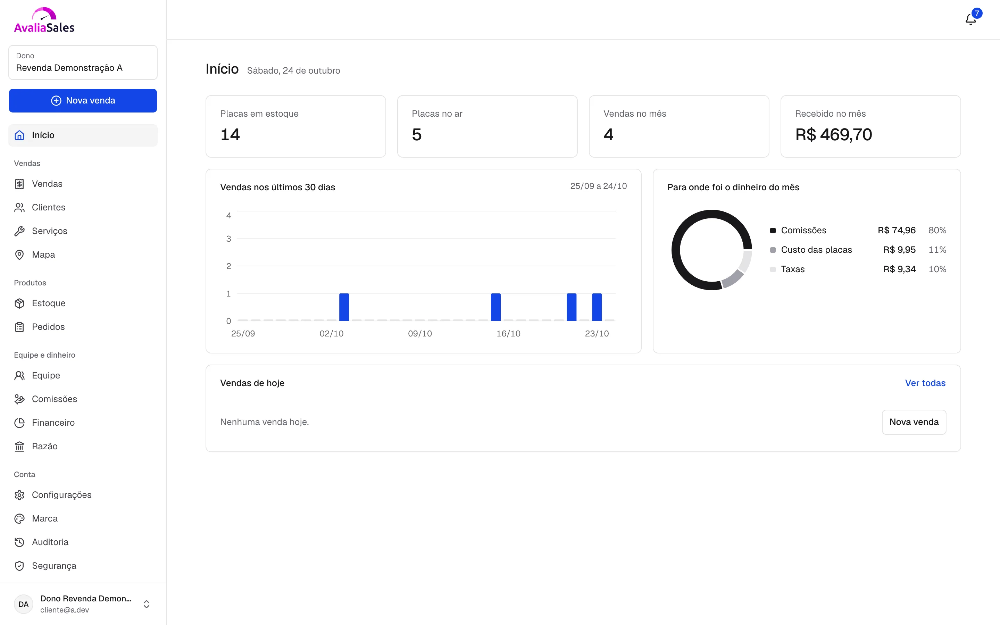
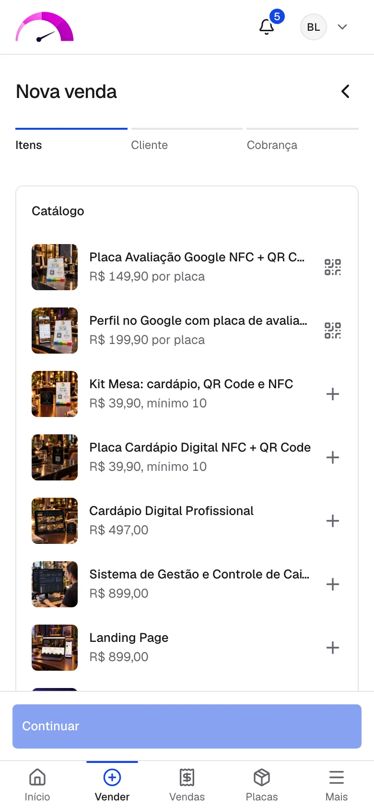
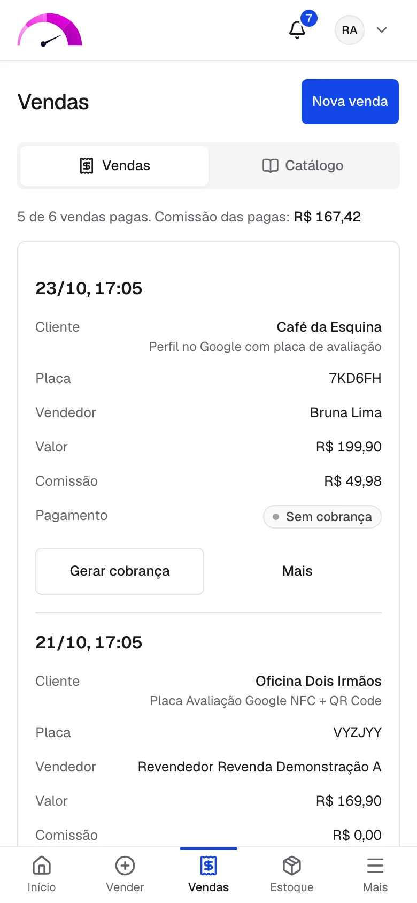

# Avalia Sales

Plataforma de gestão e revenda de produtos, em produção em
[sales.avaliaone.com.br](https://sales.avaliaone.com.br). Uma rede de revendas
vende placas com QR Code e NFC, que levam o cliente à avaliação no Google ou a um
link, e serviços que a operadora executa. Cada revenda trabalha com a própria
marca (white label), a própria equipe e o próprio caixa.

A stack em produção, com a situação de cada peça e os fluxos da venda, da
arquitetura e da publicação, está em
[sales.avaliaone.com.br/now](https://sales.avaliaone.com.br/now). A versão
publicada aparece no rodapé do app e segue o `version` de `web/package.json`.


## Como funciona

### Papéis

| Papel | O que faz |
| --- | --- |
| Operadora | Cadastra o catálogo, produz e despacha os lotes de placas, executa os serviços vendidos e atende os chamados |
| Revendedor | Compra placas, monta a equipe, define preço e comissão, acompanha vendas, estoque, mapa, comissões e o financeiro do mês |
| Vendedor | Vende no balcão pelo celular: escolhe os itens, lê o QR da placa, cobra e grava o NFC |
| Cliente final | Paga por Pix ou cartão e usa a placa no negócio |

### Uma venda, do balcão ao Google

1. **Itens** - placa e serviço na mesma venda. Cada item é uma venda com a
   comissão dela, e o grupo compartilha uma cobrança só.
2. **Placa** - a câmera lê o QR, e o código da placa fica vinculado ao cliente.
3. **Checkout** - Pix ou cartão. A cobrança é gravada antes da chamada ao
   Pagar.me, com o próprio id como código: uma queda no meio não cobra duas
   vezes. O cartão vira token no navegador.
4. **Confirmação** - o webhook do Pagar.me é gravado uma vez, o Worker reconfere
   a cobrança na fonte, e o PostgreSQL avisa no commit. O SignalR leva o aviso à
   tela do vendedor.
5. **Split** - o pagamento chega dividido entre a revenda e a operadora, e a
   comissão do vendedor entra no razão.
6. **Ativação** - a placa passa a redirecionar para o destino do cliente, e o
   NFC é gravado pelo navegador.

Cancelar devolve só a parte do item cancelado (estorno parcial). O endereço
impresso na placa (`/q/{codigo}`) é da plataforma e redireciona com 302 sem
cache: o destino muda sem reimprimir, e a placa vendida responde para sempre.

### Depois da venda

- **Razão** - só de inserção: correção vira estorno, nada se apaga. Comissões e
  repasses saem dele.
- **Financeiro** - DRE do mês, despesas, retiradas de sócio, perdas de placa e
  fechamento do mês, com o mês fechado garantido por trigger no banco.
- **Renovação** - a placa vale 12 meses e se renova com uma cobrança nova, sem
  trocar o endereço impresso.
- **Serviços** - a venda paga de um serviço vira ordem para a operadora, com a
  quantidade vendida.

## Telas

Imagens demonstrativas, com os dados de demonstração.



| Nova venda no celular do vendedor | Vendas no celular do revendedor |
| --- | --- |
|  |  |

## Arquitetura

```
Navegador (React) ──┐                       ┌── PostgreSQL (RLS por revenda)
Leitura do QR ──────┼── Nginx (TLS) ── API ─┤
Webhooks ───────────┘                       │   pg_notify ── SignalR ── navegador
                                            │
                                 Worker ────┴── Pagar.me, D4Sign, Resend, Google,
                                                BrasilAPI, Gotenberg, Protheus
```

A API responde e grava sem esperar integração; o Worker resolve com retentativa.
O PostgreSQL liga os dois, leva os avisos ao vivo e é a última barreira de
isolamento entre revendas.

| Projeto | Papel |
| --- | --- |
| `src/AvaliaSales.Domain` | Entidades e regras de negócio, sem dependência de outro projeto |
| `src/AvaliaSales.Application` | Casos de uso e as interfaces de que eles precisam |
| `src/AvaliaSales.Infrastructure` | EF Core e PostgreSQL, Identity, migrations, clientes das integrações e simuladores |
| `src/AvaliaSales.Api` | Rotas HTTP por área, autenticação JWT, webhooks, leitura do QR e modos de linha de comando |
| `src/AvaliaSales.Worker` | Webhooks, retomadas, conferência de pagamento e de assinatura, filas de e-mail e de ERP, PDF |
| `web` | Front único em React: painel do revendedor, área da operadora, app do vendedor e a página `/now` |
| `tests/AvaliaSales.Tests` | Unidade, contrato HTTP das integrações e fluxo completo no PostgreSQL |

### Decisões que sustentam o resto

- **Multi-tenant em banco único** - toda tabela de negócio tem `revendedor_id`,
  com filtro global do EF Core e row-level security forçado. A API conecta com o
  papel `avalia_app`, sem superusuário e sem `BYPASSRLS`, e um teste falha se uma
  tabela nova nascer sem política.
- **Dinheiro em centavos** - `bigint` para valor e pontos base para taxa; preço,
  comissão e taxa ficam gravados na venda.
- **Webhook não é confiável** - a rota só grava o evento cru, com chave única
  (`ON CONFLICT DO NOTHING`), e o Worker reconsulta a fonte antes de mudar
  qualquer coisa. Dois Workers nunca pegam o mesmo evento (`FOR UPDATE SKIP LOCKED`).
- **Migrations aditivas** - a versão anterior lê o banco novo, então voltar o
  deploy não pede restauração.
- **Contrato da API versionado** - os tipos do front são gerados do OpenAPI, e o
  CI recusa divergência.

Cada decisão estrutural está registrada em [docs/adr](docs/adr/README.md), no
formato MADR.

## Integrações

Cada integração fica atrás de uma interface, com simulador em desenvolvimento e
teste de contrato HTTP contra servidor falso.

| Integração | Para quê | Situação |
| --- | --- | --- |
| Pagar.me | Checkout com cupom, Pix e cartão, split entre recebedores, estorno total e parcial | Produção |
| D4Sign | Contrato de revenda e distrato assinados eletronicamente | Sandbox |
| Resend | E-mails transacionais, com fila na transação e retentativa exponencial | Produção |
| Google Places e Maps | Achar o negócio do cliente e o mapa das vendas por cidade | Produção |
| BrasilAPI | Razão social e endereço pelo CNPJ e pelo CEP | Produção |
| Gotenberg | Contrato e distrato em PDF, num contêiner sem rede | Produção |
| Sentry | Erros da API, do Worker e do front, com o commit publicado como versão | Produção |
| Protheus | Pedido de placas pago vira pedido de venda no ERP, uma vez só | Conector com simulador |

## Stack

| Camada | Tecnologias |
| --- | --- |
| Back-end | C# e .NET, ASP.NET Core (minimal APIs), Worker Service, EF Core, ASP.NET Identity com JWT, SignalR, Polly |
| Front-end | React, TypeScript, Vite, React Router, TanStack Query, Zustand, React Hook Form, Zod, Tailwind CSS, shadcn/ui, Recharts |
| Dados | PostgreSQL com row-level security, LISTEN/NOTIFY |
| Infraestrutura | Linux, Docker e Docker Compose, Nginx, Let's Encrypt, backup diário com cópia fora do servidor |
| Entrega | GitHub Actions com runner self-hosted e aprovação de ambiente |
| Qualidade | xUnit, Vitest, Playwright com axe, Storybook, gitleaks, Sentry |

As versões ficam fixadas em `Directory.Packages.props` e `web/package.json`. O
design system está descrito em [DESIGN.md](DESIGN.md).

## Qualidade

- Cerca de 470 testes automáticos por publicação: 340 na API, 116 no front
  (incluindo cada história do Storybook com o axe) e 16 jornadas ponta a ponta
  no celular e no computador.
- Os testes da API rodam contra um PostgreSQL de verdade, com o mesmo papel e o
  mesmo RLS da produção.
- Erro em produção chega pelo Sentry com a versão publicada, vira um teste que
  reproduz, e o commit da correção fecha o alerta.

## Segurança e LGPD

- Token de acesso de vida curta, só em memória, e refresh rotativo em cookie
  HttpOnly; um token reapresentado encerra a sessão inteira.
- Bloqueio por tentativas, limite por IP e segundo fator por TOTP ou e-mail.
- Cartão tokenizado no navegador: a plataforma nunca vê número nem CVV.
- HSTS, CSP e Permissions-Policy na borda; Swagger e OpenAPI só em Development.
- Auditoria só de inserção. A revenda é a controladora e a plataforma a operadora
  dos dados, com exportação e anonimização do cliente.

## Documentação

| Documento | Conteúdo |
| --- | --- |
| [docs/PDD.md](docs/PDD.md) | Produto - papéis, jornada, telas, regras de negócio, dinheiro e decisões pendentes |
| [docs/SDD.md](docs/SDD.md) | Software - arquitetura, isolamento entre revendas, modelo de dados, integrações, segurança, infraestrutura e CI |
| [docs/adr](docs/adr/README.md) | Cada decisão estrutural, no formato MADR |
| [docs/OPERACAO.md](docs/OPERACAO.md) | Instalação no VPS, publicação, volta, backup, restauração e importação de placas |
| [DESIGN.md](DESIGN.md) | Tokens, componentes, regras de white label, movimento e as travas de lint |

Toda mudança de regra, tabela, integração ou configuração atualiza o PDD ou o
SDD no mesmo commit, com uma linha no registro de mudanças do fim.

## Desenvolvimento

Requisitos: .NET 10 SDK, Node 24 e PostgreSQL 17 (no macOS,
`brew install postgresql@17` e `pg_ctl -D /opt/homebrew/var/postgresql@17 start`).

### Testes

```bash
dotnet test                 # API: cria um banco descartável por execução e apaga no fim
cd web && npm run test      # front: Vitest, com as histórias do Storybook no Chromium
cd web && npm run e2e       # ponta a ponta: Playwright com axe, contra a API local
cd web && npm run lint      # inclui as travas do design system
```

O `dotnet test` conecta em `localhost` com o usuário do sistema. Para outro
servidor, defina a conexão de administrador em `AVALIA_SALES_PG_ADMIN`.

O `ContratoDaApiTest` regenera `web/openapi.json` quando uma rota muda e falha
nessa primeira execução; depois, `cd web && npm run tipos` atualiza
`src/api/esquema.d.ts`. O CI recusa contrato ou tipos desatualizados.

### API e Worker locais

Com um banco `avalia_sales_dev` e o papel `avalia_app` criados:

```bash
export ASPNETCORE_ENVIRONMENT=Development DOTNET_ENVIRONMENT=Development
export ConnectionStrings__Banco="Host=localhost;Database=avalia_sales_dev;Username=avalia_app;Password=<senha do papel>"
export Jwt__Chave="$(openssl rand -base64 48)"
export Pagarme__ChaveSecreta=sk_test_local Pagarme__RecebedorAvalia=rp_local Pagarme__SegredoDoWebhook=<32 caracteres ou mais>
export D4Sign__TokenApi=local D4Sign__SegredoHmac=<segredo> D4Sign__Cofre=local D4Sign__UrlDoWebhook=https://exemplo/webhooks/d4sign

ConnectionStrings__Dono="Host=localhost;Database=avalia_sales_dev;Username=$USER" \
  dotnet run --project src/AvaliaSales.Api --no-launch-profile -- --migrar
dotnet run --project src/AvaliaSales.Api --no-launch-profile -- --demonstracao
ASPNETCORE_URLS=http://127.0.0.1:5199 dotnet run --project src/AvaliaSales.Api --no-launch-profile
dotnet run --project src/AvaliaSales.Worker --no-launch-profile   # em outro terminal, com as mesmas variáveis
```

Em Development, o Pagar.me, o Protheus e o conversor de PDF rodam simulados
(`appsettings.Development.json`): o Pix fica pago 20 segundos depois, e o
contrato sai como um PDF mínimo. Resend, Google Places e BrasilAPI são
opcionais: sem chave, o e-mail espera na fila e a busca no Google pede o link
colado.

Swagger em `http://127.0.0.1:5199/swagger` (só em Development), saúde em
`/health` e leitura de placa em `/q/{codigo}`.

### Front

```bash
cd web && npm ci && npm run dev   # http://localhost:5173; /api e /q/ vão para a API local
npm run storybook                 # catálogo de componentes, porta 6006
```

A página `/now` é estática, em `web/public/now`: no servidor de desenvolvimento,
abra `http://localhost:5173/now/index.html`.

### Dados de demonstração

O `--demonstracao` cria, todos com a senha `demo-123`:

| Login | Papel |
| --- | --- |
| `operador@avalia.dev` | Operadora |
| `cliente@a.dev` e `vendedor@a.dev` | Revendedor e vendedora da revenda A, com placas no ar, vendas pagas e pendentes e um lote esperando ativação |
| `cliente@b.dev` e `vendedor@b.dev` | Revendedor e vendedor da revenda B |

Operadora e revenda também podem ser criadas pela linha de comando (a revenda
também se cadastra pela tela):

```bash
dotnet run --project src/AvaliaSales.Api --no-launch-profile -- \
  --nova-operadora --nome="Operação Avalia" --email=operacao@exemplo.com.br --senha=<10 caracteres ou mais>
dotnet run --project src/AvaliaSales.Api --no-launch-profile -- \
  --novo-revendedor --nome="Revenda" --email=revendedor@exemplo.com.br --senha=<10 caracteres ou mais>
```

### NFC e câmera no celular

Web NFC e câmera só funcionam em HTTPS ou em `localhost`. Para testar no
celular na mesma rede, gere um certificado local e suba o front no IP da rede:

```bash
IP=$(ipconfig getifaddr en0)   # no Linux: hostname -I | cut -d' ' -f1
openssl req -x509 -newkey rsa:2048 -sha256 -days 30 -nodes -keyout chave.pem -out certificado.pem \
  -subj "/CN=Avalia Sales local" -addext "subjectAltName=IP:$IP,DNS:localhost"
cd web && FRONT_NA_REDE=1 FRONT_CERTIFICADO=../certificado.pem FRONT_CHAVE=../chave.pem npm run dev
```

Suba a API com `Plataforma__UrlPublica` e `Plataforma__UrlDoPainel` em
`https://$IP:5173`, para o QR e a tag gravada apontarem para um endereço que o
celular alcança. A gravação de NFC só existe no Chrome do Android; no iPhone, o
app abre o NFC Tools com o endereço copiado.

## Produção

VPS Linux com Docker Compose (`docker-compose.producao.yml`): Nginx com
Let's Encrypt, API, Worker, Gotenberg, PostgreSQL e backup diário. Só o Nginx
publica porta.

Publicação: push no `main`, CI verde (build, testes da API e do front, ponta a
ponta com axe, segredos e qualidade) e o workflow Deploy, que espera a aprovação
do ambiente `producao` no GitHub e roda no runner do próprio VPS. Voltar é
publicar o commit anterior. Passo a passo, segredos e backup em
[docs/OPERACAO.md](docs/OPERACAO.md).
